# Big Data - sprawozdanie z projektu 

*Aleksandra Frączek, Karolina Kokoszka* 

**Temat:** Analiza przejazdów Citi Bike (Nowy Jork) z wykorzystaniem MongoDB, HDFS i Hadoop Streaming  
**Zakres danych w realizacji:** rok 2024 (archiwa miesięczne Citi Bike)  
**Rozmiar danych po wypakowaniu:** ok. **8,06 GB** po wypakowaniu <br>
**Język:** Python  

---

## 1. Cel projektu i problem badawczy

Celem projektu było przygotowanie aplikacji big data, która:

1. pobiera dane z otwartego źródła internetowego,
2. zapisuje je lokalnie i w rozproszonym systemie plików HDFS,
3. czyści i sprawdza jakość rekordów,
4. wykonuje analizy statystyczne lokalnie (Pandas) oraz w modelu MapReduce (Hadoop Streaming),
5. zapisuje wyniki analizy w MongoDB Atlas,
6. prezentuje wyniki w dashboardzie.

Analizowany problem: **jak wygląda korzystanie z miejskiego systemu rowerów Citi Bike w Nowym Jorku w ciągu roku 2024?**  

W ramach analizy uwzględniono następujące zagadnienia:
- w których miesiącach jest najwięcej przejazdów,
- czy abonenci (`member`) jeżdżą inaczej niż okazjonalni użytkownicy (`casual`),
- jakiego typu rowerów używa się najczęściej,
- które stacje startowe są najbardziej obciążone,
- jak rozkładają się przejazdy w ciągu tygodnia i doby.

Tego typu informacje mogą być przydatne w optymalizacji zarządzania dostępnością liczby rowerów, planowaniu ich rozmieszczenia między stacjami oraz ocenie sezonowości ruchu.

---

## 2. Opis źródła i danych

### 2.1. Źródło danych

Głównym źródłem jest oficjalna strona Citi Bike:

- [https://citibikenyc.com/system-data](https://citibikenyc.com/system-data)

Strona opisuje dostęp do historii przejazdów i wskazuje listing plików. 

Z tej strony aplikacja:
- pobiera HTML,
- wyciąga tytuł, opis i listę pól trip history,
- znajduje link do listingu archiwów,
- buduje listę plików `.zip` do pobrania.

Listing archiwów znajduje się w chmurze Amazon S3:

- HTML: `https://s3.amazonaws.com/tripdata/index.html`
- XML (fallback): `https://s3.amazonaws.com/tripdata?list-type=2`

### 2.2. Format danych

Dane są publikowane jako:

- archiwa miesięczne `.zip`,
- wewnątrz każdego archiwum jeden lub więcej plików `.csv`.

Przykładowa nazwa pliku:

```text
202401-citibike-tripdata.zip
```

Po rozpakowaniu powstają CSV z rekordami pojedynczych przejazdów.

### 2.3. Pola w zbiorze

Każdy przejazd zawiera m.in.:

| Pole | Znaczenie |
|---|---|
| `ride_id` | unikalny identyfikator przejazdu |
| `rideable_type` | typ roweru (`classic_bike`, `electric_bike`) |
| `started_at` | data i godzina startu |
| `ended_at` | data i godzina zakończenia |
| `start_station_name` / `start_station_id` | stacja startowa |
| `end_station_name` / `end_station_id` | stacja końcowa |
| `start_lat` / `start_lng` | współrzędne startu |
| `end_lat` / `end_lng` | współrzędne końca |
| `member_casual` | typ klienta (`member` lub `casual`) |

W trakcie czyszczenia dodawane są też pola wyliczane:

- `trip_duration_minutes` - czas przejazdu w minutach,
- `trip_year`, `trip_month`, `trip_day_of_week`, `trip_hour`,
- `source_file` - nazwa pliku źródłowego.

### 2.4. Zakres i objętość danych

W projekcie analizowane są dane z roku **2024** (12 miesięcy). Po wypakowaniu CSV zajmują ok. **8,06 GB**.

Po czyszczeniu w analizie lokalnej i w MapReduce uzyskano:

- **44 291 954** przejazdów (wiersze po filtrach),
- typy klientów: `member`, `casual`,
- typy rowerów: `classic_bike`, `electric_bike`.

Uwaga: w danych pojawia się też bardzo mała liczba rekordów z datą `2023-12` (374 przejazdy). To efekt rekordów, które weszły do archiwum 2024, ale mają datę startu jeszcze w grudniu 2023. Nie wpływają istotnie na wnioski roczne.

---

## 3. Architektura - przepływ danych

Przetwarzanie danych w projekcie realizowane jest w postaci wieloetapowego pipeline, obejmującego kolejne etapy pozyskiwania, przechowywania, oczyszczania i analizy danych. Przepływ danych pomiędzy poszczególnymi etapami:

```text
1. Scraping strony system-data
2. Manifest (lista ZIP-ów do pobrania)
3. Pobranie ZIP + rozpakowanie do CSV
4a. Czyszczenie -> lokalne MongoDB (oczyszczone przejazdy)
4b. Upload ZIP -> HDFS /tripdata/raw  (główny zbiór)
5. Pobranie ZIP z HDFS -> czyszczenie -> TSV
6. TSV -> HDFS /tripdata/processed_tmp  (wejście MapReduce)
7. Hadoop Streaming (mapper + reducer)
8. Wyniki MapReduce -> MongoDB Atlas (agregaty)
9. Lokalne analizy Pandas -> CSV w outputs/
10. Dashboard Streamlit (czyta lokalne CSV)
```

**Schemat przepływu danych**

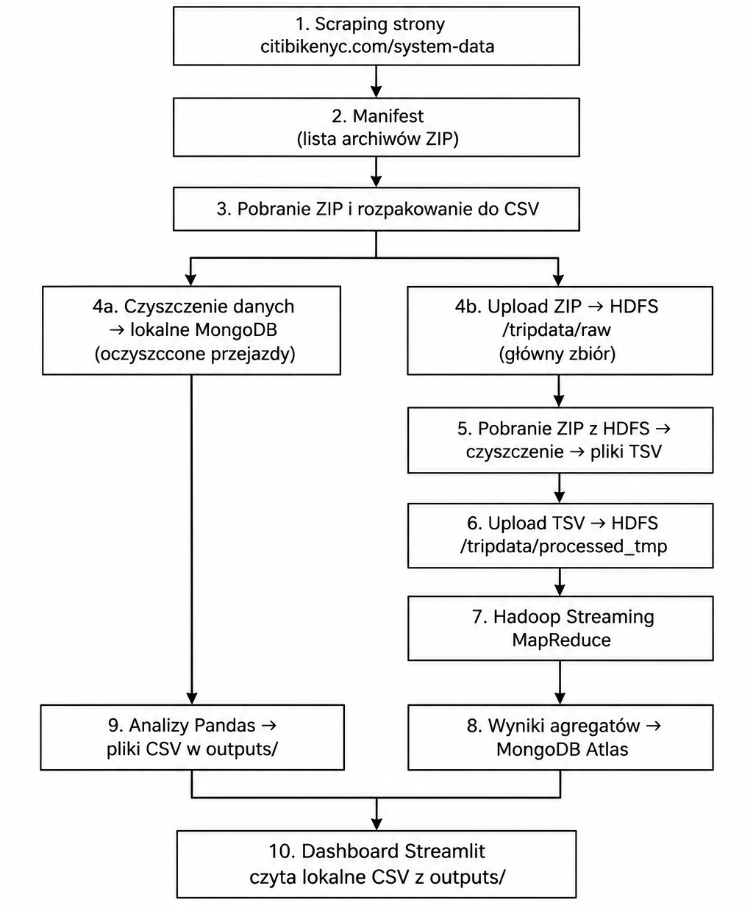

### Co gdzie jest przechowywane

| Miejsce | Co jest przechowywane | Po co |
|---|---|---|
| `data/raw/zip/` | lokalne kopie archiwów ZIP | pobranie i staging |
| `data/raw/csv/` | rozpakowane CSV | import do lokalnego Mongo i analizy Pandas |
| lokalne MongoDB | oczyszczone pojedyncze przejazdy + metadane importu | baza operacyjna / dokumentacja ETL |
| HDFS `/tripdata/raw` | **główny zbiór** = oryginalne ZIP | wymaganie projektowe |
| HDFS `/tripdata/processed_tmp` | oczyszczone TSV | wejście Hadoop Streaming |
| `data/processed/` | lokalny cache TSV | ponowne przygotowanie |
| MongoDB Atlas | agregaty z MapReduce | baza chmurowa z wynikami analizy |
| `outputs/` | CSV, TSV wyników, raporty | dashboard |

---

## 4. Szczegółowy opis implementacji

### 4.1. Struktura projektu

```text
project1/
├── app/dashboard.py                 # dashboard Streamlit
├── bigdata_project/                 # wspólna logika
│   ├── config.py                    # ustawienia z .env
│   ├── manifest.py                  # scraping + manifest
│   ├── download.py                  # pobieranie i rozpakowanie
│   ├── transform.py                 # czyszczenie danych
│   ├── mongo_ops.py                 # Mongo lokalne i Atlas
│   └── hdfs_ops.py                  # WebHDFS
├── scripts/                         # kolejne etapy pipeline
├── hadoop/                          # Hadoop Streaming (maper, reducer)
├── tests/                           # testy jednostkowe
├── docker-compose.yml               # Mongo + HDFS
└── outputs/                         # wyniki i raporty
```

### 4.2. Użyte technologie

- **Python** - cały pipeline,
- **BeautifulSoup + requests** - scraping HTML,
- **pandas** - czyszczenie i lokalne analizy,
- **pymongo** - lokalne MongoDB i Atlas,
- **Docker Compose** - lokalne MongoDB, NameNode, DataNode,
- **HDFS + WebHDFS** - przechowywanie głównego zbioru,
- **Hadoop Streaming** - MapReduce w Pythonie,
- **Streamlit** - wizualizacja,
- **pytest** - testy logiki scrapingu i czyszczenia.

### 4.3. Konfiguracja

Parametry połączeń i ścieżek trzymane są w pliku .env, a nie bezpośrednio w kodzie. Dzięki temu łatwo zmienić środowisko bez edycji skryptów.
W konfiguracji zapisywane są m.in. adres lokalnego MongoDB (localhost:27018 z loginem i hasłem), połączenie do MongoDB Atlas (mongodb+srv://...), adres WebHDFS oraz ścieżki w HDFS, w tym katalog głównego zbioru /tripdata/raw i katalog wejścia MapReduce /tripdata/processed_tmp.

### 4.4. Scraping i manifest

Skrypt:

```powershell
python scripts/scrape_tripdata.py --years 2024
```

działa nastepująco:

1. pobiera stronę `https://citibikenyc.com/system-data`,
2. wyciąga metadane strony (tytuł, opis, pola trip history),
3. znajduje link do listingu ZIP,
4. buduje listę miesięcznych archiwów dla wybranego roku,
5. zapisuje:
   - manifest: `data/manifests/tripdata_manifest_2024_2025.json`,
   - raport scrapingu: `outputs/system_data_scrape.json`.

Jeśli listing HTML jest niedostępny, jest fallback do listingu XML S3.  
W naszej realizacji raport pokazał źródło `xml-fallback` i 12 wpisów dla 2024.

### 4.5. Pobranie i staging

Skrypt:

```powershell
python scripts/download_and_stage.py --year 2024
```

działa nastepująco:

- czyta manifest,
- pobiera ZIP-y do `data/raw/zip/`,
- rozpakowuje CSV do `data/raw/csv/YYYY/MM/`,
- jeśli ZIP już istnieje i jest poprawny, nie pobiera go drugi raz.

### 4.6. Czyszczenie danych

Wspólna logika jest w `bigdata_project/transform.py` (`normalize_chunk`) i jest używana:

- przy imporcie do lokalnego Mongo,
- przy przygotowaniu TSV do MapReduce,
- przy lokalnych analizach Pandas.

Reguły czyszczenia:

1. wymagane kolumny muszą istnieć,
2. brakujące `ride_id`, daty lub `member_casual` -> odrzucenie,
3. koniec przejazdu nie może być wcześniejszy niż start,
4. czas przejazdu nie może przekraczać 24 godzin,
5. brakujące nazwy stacji / typów uzupełniane są wartością `unknown`,
6. odrzucane sa starty wyraźnie poza obszarem NYC (prosty filtr współrzędnych).

### 4.7. Lokalne MongoDB - import bez duplikatów

Skrypt:

```powershell
python scripts/load_local_mongo.py --year 2024
```

Baza: `tripdata_local` (kontener Docker, port `27018`).

Główna kolekcja:

- `tripdata_cleaned_local` - oczyszczone pojedyncze przejazdy.

Dodatkowo:

- `imported_files` - status importu per archiwum,
- `import_runs` - log uruchomień,
- `data_quality_reports` - ile wierszy weszło / zostało / odrzucono.

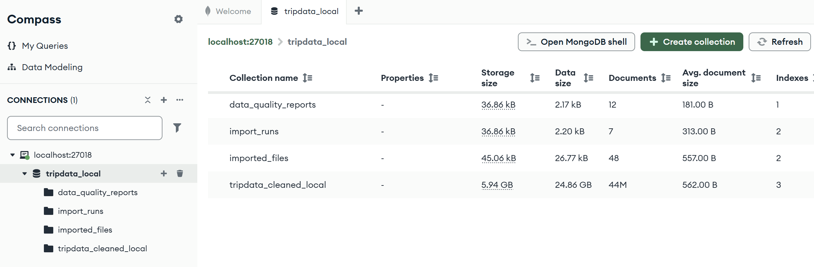

#### Idempotentność 

1. `_id` dokumentu = `ride_id::source_file` -> ten sam przejazd nie tworzy drugiego rekordu,
2. zapis przechodzi przez `upsert` (`bulk_write` + `UpdateOne`),
3. jeśli plik ma już status `loaded_local_mongo`, skrypt go pomija.

Dzięki temu ponowne uruchomienie jest bezpieczne.

### 4.8. HDFS - główny zbiór danych

Główny zbiór danych jest w HDFS, a w Atlas trafiają wyniki analiz / agregaty.

Skrypt:

```powershell
python scripts/push_to_hdfs.py --year 2024
```

wrzuca oryginalne archiwa ZIP do:

```text
/tripdata/raw/year=YYYY/month=MM/...zip
```

To jest **główny zbiór** w HDFS.

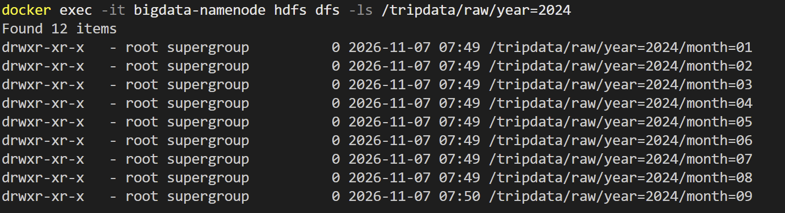

### 4.9. Przygotowanie wejścia do MapReduce

Hadoop Streaming dobrze działa na tekstowych, dzielnych plikach liniowych.  
Format ZIP nie jest wygodny do bezpośredniego dzielenia na bloki w Streaming, dlatego:

1. ZIPy są pobierane z HDFS (`WebHDFS`),
2. następnie są rozpakowywane i czyszczone tą samą logiką co Mongo,
3. w kolejnym kroku TSV są lokalnie zapisywane do `data/processed/`,
4. oraz TSV są wrzucane do HDFS `/tripdata/processed_tmp/...`.

Skrypt:

```powershell
python scripts/prepare_mapreduce_input.py --year 2024
```

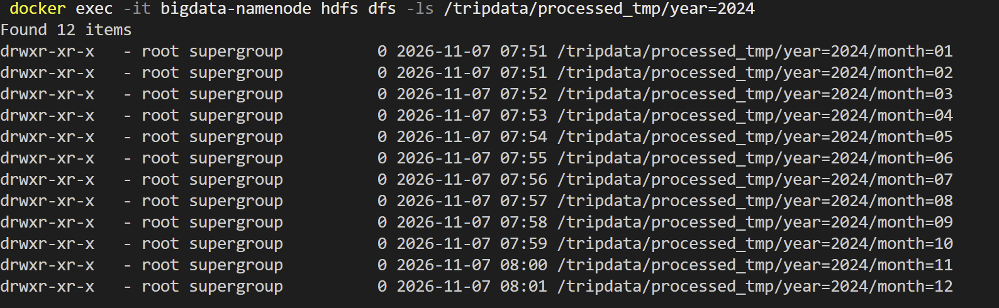

### 4.10. Hadoop Streaming - MapReduce

Skrypt uruchamiający:

```powershell
python scripts/run_mapreduce.py
```

Działa w kontenerze NameNode i używa:

- `hadoop/mapper.py`,
- `hadoop/reducer.py`,
- wejścia z `/tripdata/processed_tmp`,
- wyjścia do `/tripdata/output_stats`,
- eksportu wyniku do `outputs/mapreduce_results.tsv`.

#### Mapper

Dla każdej linii TSV (jeden przejazd) tworzy kilka kluczy naraz:

- przejazdy per miesiąc,
- czas per typ klienta,
- przejazdy per typ roweru,
- przejazdy per dzień tygodnia,
- przejazdy per stacja startowa,
- przejazdy per godzina i typ klienta.

Dla każdego klucza liczy lokalnie: liczbę, sumę czasów i sumę kwadratów czasów (pod odchylenie standardowe).

#### Reducer

Łączy wyniki z mapperów i w trybie końcowym wypisuje:

- metric,
- dimension,
- liczbę przejazdów,
- sumę czasu,
- średni czas,
- odchylenie standardowe.

Reducer jest też używany jako combiner (sumy częściowe), żeby zmniejszyć ilość danych między map a reduce.

W pełnym uruchomieniu na 2024 job przetworzył:

- **Map input records = 44 291 954**,
- **Reduce output records = 2346**.

### 4.11. MongoDB Atlas - wyniki analiz

Skrypt:

```powershell
python scripts/load_results_atlas.py
```

czyta `outputs/mapreduce_results.tsv` i zapisuje dokumenty do Atlas:

- baza: `tripdata_analytics` (domyślnie),
- kolekcja: `mapreduce_results`.

Klucz dokumentu: para `metric` + `dimension` (upsert).  
Do Atlas nie trafiają miliony surowych przejazdów, tylko agregaty.
Połączenie do Atlas jest przez `mongodb+srv` (TLS + uwierzytelnienie).
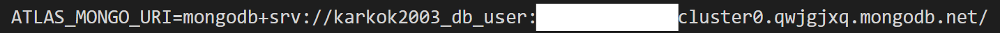

MongoDB Atlas - kolekcja `mapreduce_results` z przykładowymi dokumentami:
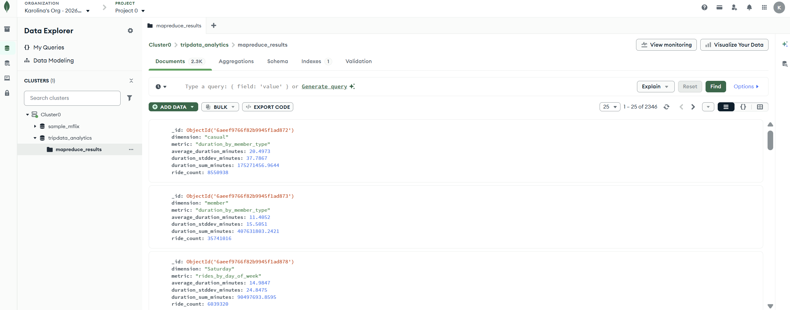

### 4.12. Lokalne analizy i dashboard

Skrypt:

```powershell
python scripts/run_local_analysis.py
```

liczy w Pandas m.in.:

- liczbę przejazdów per miesiąc,
- średni czas per typ klienta,
- udział typów rowerów,
- top 10 stacji startowych,

i zapisuje CSV do `outputs/`.

Dashboard:

```powershell
streamlit run app/dashboard.py
```

czyta te lokalne CSV.  
Równolegle wyniki Hadoop są w Atlas. 


### 4.13. Bezpieczeństwo połączeń

| System | Uwierzytelnienie | Szyfrowanie |
|---|---|---|
| lokalne MongoDB (Docker) | tak (`bigdata` / hasło) | nie (lokalny Docker) - **zaakceptowane** |
| MongoDB Atlas | tak (użytkownik Atlas) | tak (TLS / `mongodb+srv`) |
| HDFS WebHDFS | użytkownik HDFS (`HDFS_USER`) | HTTP lokalnie w Dockerze |

Hasła i URI są w `.env`, nie w repozytorium.

---

## 5. Uruchomienie aplikacji - instrukcja 

### 5.1. Przygotowanie środowiska

```powershell
python -m venv .venv
.venv\Scripts\Activate.ps1
pip install -r requirements.txt
Copy-Item .env.example .env
```

W `.env` należy ustawić:

```env
HDFS_USER=root
ATLAS_MONGO_URI=...   # własne URI Atlas
```

Start usług:

```powershell
docker compose up -d --build
```

### 5.2. Pełny przebieg dla roku 2024

```powershell
python scripts/scrape_tripdata.py --years 2024
python scripts/download_and_stage.py --year 2024
python scripts/load_local_mongo.py --year 2024
python scripts/run_local_analysis.py
python scripts/push_to_hdfs.py --year 2024
python scripts/prepare_mapreduce_input.py --year 2024
python scripts/run_mapreduce.py
python scripts/load_results_atlas.py
streamlit run app/dashboard.py
```

---

## 6. Wyniki analiz i interpretacja

Poniższe liczby pochodzą z uruchomienia pipeline na danych 2024  

### 6.1. Skala danych

- po czyszczeniu: **44 291 954** przejazdów,
- MapReduce: **44 291 954** rekordów wejściowych mappera,
- wynik MapReduce: **2346** grup statystycznych.

### 6.2. Liczba przejazdów per miesiąc

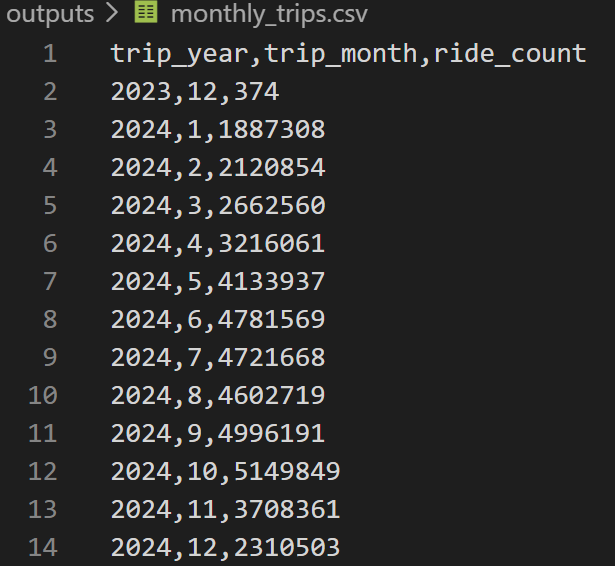

**Interpretacja:** widać sezonowość, zima (I, II, XII) jest wyraźnie słabsza. Szczyt przypada na późne lato / wczesną jesień - najwięcej przejazdów w **październiku 2024**.

Wykres liniowy z dashboardu: 

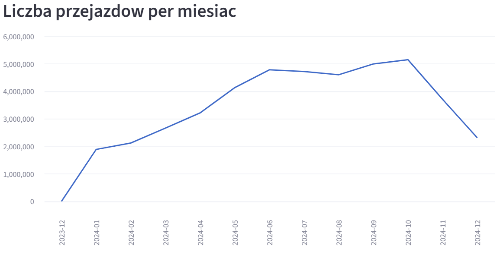

### 6.3. Średni czas przejazdu per typ klienta

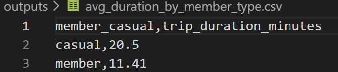

Wyniki agregacji średniego czasu trwania przejazdów wg typu użytkowanika w MongoDB Atlas:

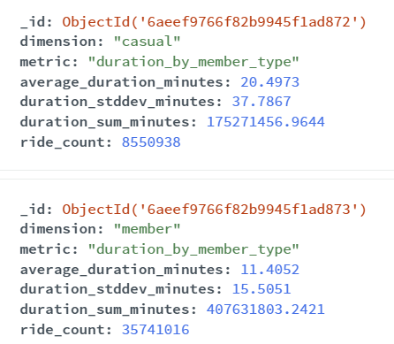

**Interpretacja:** abonenci jeżdżą częściej i krócej - typowo dojazdy. Użytkownicy okazjonalni jeżdżą rzadziej, ale dłużej - częściej turystyka / rekreacja. Większość ruchu to `member`.

Wykres z dashboardu: 

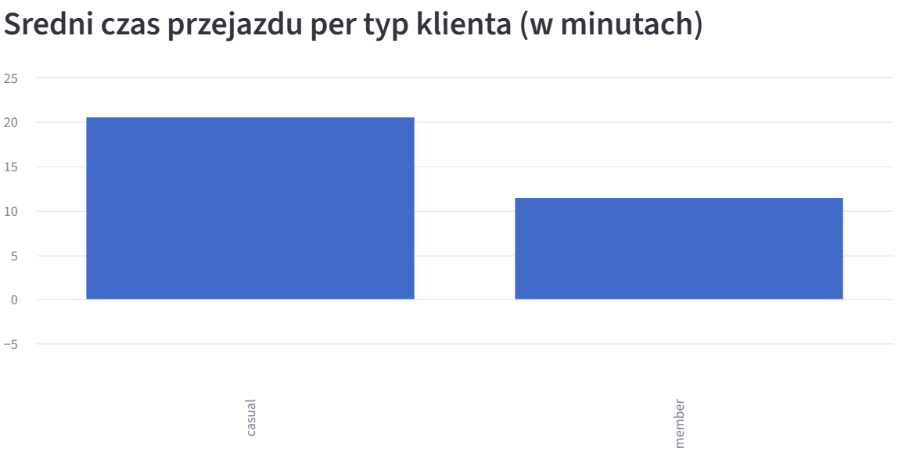

### 6.4. Udział typów rowerów

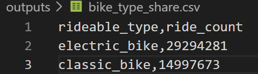

**Interpretacja:** rower elektryczny dominuje - ok. 2/3 przejazdów. To pokazuje, że rowery e-bike mają kluczowe znaczenie dla systemu.

Wykres z dashbordu:

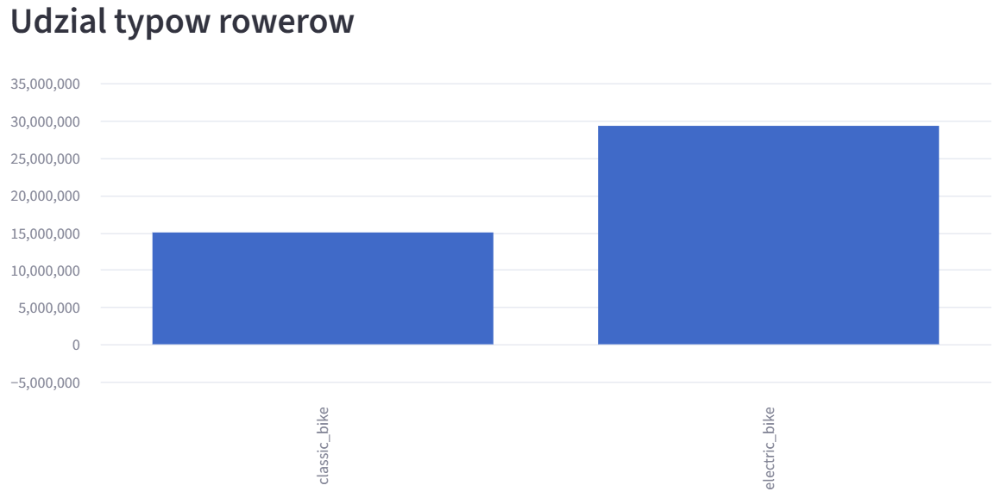

### 6.5. Top stacje startowe

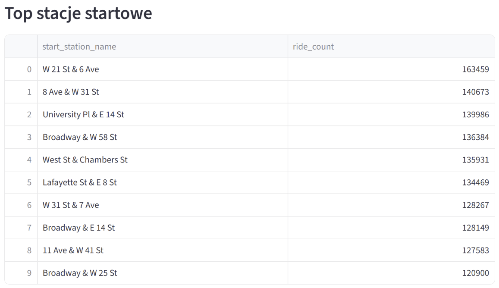

**Interpretacja:** największy ruch startuje w centralnych lokalizacjach Manhattanu.

### 6.6. Dni tygodnia 

Najwięcej przejazdów jest w dni robocze (szczyt we wtorek/środę).  
Sobota i niedziela mają mniej przejazdów, ale dłuższy średni czas - pasuje do rekreacji weekendowej.

Wykresy przygotowane w MongoDB Atlas Charts na podstawie agregatów z kolekcji `mapreduce_results`: 

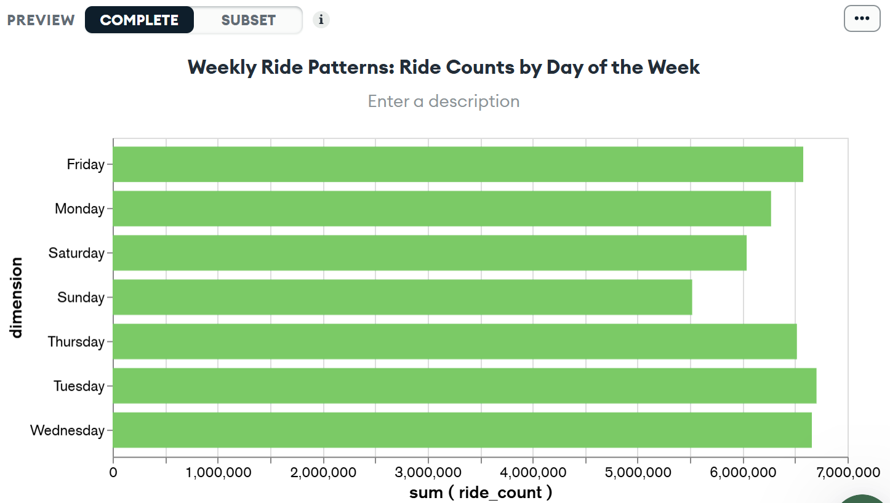

<div style="break-before: page;"></div>

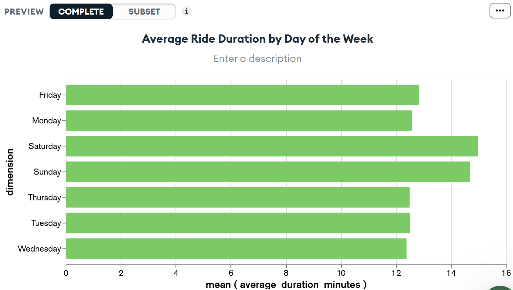
---

## 7. Ograniczenia 

- dashboard czyta lokalne CSV z Pandas, a nie bezpośrednio Atlas,
- MapReduce nie czyta ZIP bezpośrednio - potrzebny etap TSV,
- lokalne Mongo bez TLS,
- filtr geograficzny NYC jest uproszczony (prostokąt współrzędnych).

---

## 8. Podsumowanie

1. Został zbudowany kompletny pipeline big data: od scrapingu i pobrania, przez czyszczenie, dwie bazy Mongo, HDFS i Hadoop Streaming, aż do dashboardu.
2. Główny zbiór danych jest przechowywany w HDFS jako archiwa ZIP, MapReduce pracuje na oczyszczonych TSV przygotowanych z tych ZIP-ów.
3. Lokalne Mongo trzyma oczyszczone przejazdy i metadane importu, Atlas trzyma wyniki analizy MapReduce.
4. Dane 2024 po wypakowaniu mają ponad 8 GB i ok. 44,3 mln przejazdów po czyszczeniu.
5. Najważniejsze wnioski biznesowe:
   - widoczna sezonowość - szczyt w październiku,
   - abonenci jeżdżą częściej i krócej niż użytkownicy casual,
   - dominują rowery elektryczne,
   - największy ruch startuje ze stacji w centrum Manhattanu.

---

## 9. Źródła

- Citi Bike System Data: https://citibikenyc.com/system-data  
- Listing S3 tripdata: https://s3.amazonaws.com/tripdata/index.html  
